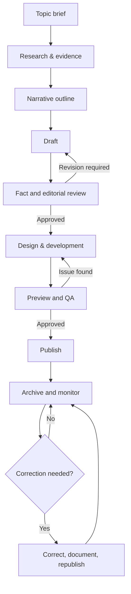

# Research 09 — Content Management, Editorial Workflow & Story Publishing
## Viraaasat

**Mission:** Design a practical editorial pipeline for publishing one deeply researched story per week: topic selection, research, writing, evidence review, asset rights, story build, preview, release, corrections, and archive.

**Context:** Viraaasat is a small team (three collaborators), a highly visual storytelling website, and a weekly publication—not a newsroom with a large CMS department. The system should be light enough to sustain, rigorous enough to protect trust, and flexible enough to support stories with very different narrative forms.

---

## 1. Executive recommendation

### Start with repository-native content, not a full CMS
For the initial build, keep content and story metadata in the repository using Markdown/MDX (or structured TypeScript/JSON for scenes that require interactive data). Use Git branches and pull requests for review, preview deployments for visual checks, and a small set of editorial checklists.

**Why this is the recommended starting point:**
- Three people can coordinate without adding a separate admin system.
- Content remains portable and versioned alongside the website.
- Every story can be art-directed and structured without a CMS schema becoming a creative constraint.
- Weekly cadence is achievable with a repeatable checklist.
- Review and approval can happen through GitHub's existing workflow.
- No CMS deployment, database, account-management, or integration overhead at the start.

**Revisit a CMS when an observable pain point appears:** nontechnical editors need to write directly in a browser; content editing becomes frequent; repository editing creates bottlenecks; asset management becomes cumbersome; drafts need a richer preview; or publishing operations are difficult to coordinate.

A CMS should solve a demonstrated workflow problem—not be installed because content websites commonly have one.

---

## 2. Editorial workflow overview

The recommended weekly pipeline has eight stages:

1. **Commission / topic brief**
2. **Research & evidence collection**
3. **Narrative outline**
4. **Draft writing**
5. **Fact-check, source review & editorial review**
6. **Story design and development**
7. **Preview, QA and release approval**
8. **Publish, archive, monitor and correct**



The pipeline should be a guide, not bureaucracy. A tiny update may skip or combine stages; a sensitive, complex story may need additional independent review.

---

## 3. The story brief

Before research begins, create a one-page brief. This prevents scope drift and makes it easier for three people to align.

### Required fields
- **Working title**
- **Story slug**
- **Topic / category**
- **Core question**
- **Why it matters now**
- **Audience takeaway:** what readers should understand by the end
- **Scope:** what is included
- **Out of scope:** what the story will not attempt to answer
- **Initial hypotheses / assumptions** (clearly marked, not presented as facts)
- **Research questions**
- **Potential narrative structure**
- **Potential interactive opportunities**
- **Evidence/data needs**
- **Risks:** sensitivity, factual uncertainty, privacy, image rights
- **Assigned owner(s)**
- **Target publish date**
- **Reviewers**

### Topic acceptance criteria
A topic is a strong candidate when:
- There is a meaningful question, not merely a broad theme.
- The team can obtain reliable primary/secondary evidence.
- The topic can be explained in the planned time.
- Visual/interactive treatment clarifies rather than decorates.
- The topic fits Viraaasat's editorial promise.
- A story can be completed sustainably within the weekly cadence.

---

## 4. Research and evidence collection

Research should be captured in a structured source ledger rather than only in browser tabs or chat messages.

### Source ledger fields
| Field | Purpose |
|---|---|
| Source ID | Stable reference (e.g. S-001) |
| Claim / question supported | What specific point it informs |
| Title | Source title |
| Publisher / author | Attribution |
| URL / document location | Retrieval |
| Publication date | Context and freshness |
| Access date | Research record |
| Source type | Primary, official dataset, academic, reporting, etc. |
| Evidence / excerpt | Short relevant note or extracted statistic |
| Reliability / limitations | Caveats, methodology, potential bias |
| Used in story? | Yes / no / pending |
| Citation placement | Chapter/paragraph/visual where used |

### Evidence hierarchy (context-dependent)
Prefer the closest reliable evidence for the claim:
1. Primary records, laws, official datasets, original research, contemporaneous documents—when they are appropriate and transparent.
2. Peer-reviewed or methodologically documented research.
3. Reputable journalism and specialist reporting.
4. Expert commentary and interviews.
5. Secondary explainers for orientation—not as sole support for consequential claims.

**Important:** Official sources are not automatically complete, neutral, or correct. Evaluate methodology, definitions, incentives, data coverage, and known limitations. For contested topics, seek independent sources with different perspectives and distinguish facts, interpretations, and opinions.

### Claim-to-source rule
Every consequential factual claim should have a source trace. For numerical claims, record:
- unit and denominator,
- geographic and temporal scope,
- definition,
- collection method (where known),
- and caveat.

Do not use a source that supports a related but different claim.

---

## 5. Narrative planning

Do not begin coding after collecting a pile of information. Create the story arc first.

### Story arc worksheet
- **Opening scene:** what captures attention and introduces the question?
- **Context:** what does the reader need to know?
- **Reveal:** what new fact, tension, or perspective changes understanding?
- **Evidence:** what proves, qualifies, or challenges the central idea?
- **Human perspective:** whose lived experience adds necessary context?
- **Interactive scene:** what should readers explore themselves, and why?
- **Quiet moment:** where should the experience slow down?
- **Synthesis:** what should the reader leave understanding?
- **Sources:** how can the reader inspect the evidence?

### Scene plan
For every scene, record:
- Scene number and title.
- Narrative purpose.
- Content or key claim.
- Source IDs.
- Media/asset requirements.
- Interaction (if any).
- Motion concept (if any).
- Static/reduced-motion alternative.
- Mobile layout.
- Estimated implementation effort.

A scene should earn its interaction. If the same point is clearer with an image, paragraph, or chart, do not add an interactive control.

---

## 6. Drafting and collaboration

### Recommended small-team division (flexible)
Roles can rotate; don't create a rigid newsroom hierarchy.

- **Story owner:** accountable for scope, structure, completion.
- **Research lead(s)::** source gathering, data, claim verification.
- **Design/development lead:** visual treatment and interactive build.
- **Editor/reviewer:** challenges claims, clarity, tone, and evidence.

A person may hold multiple roles, but **the author should not be the only person reviewing important claims**.

### Drafting stages
- **Draft 0:** rough argument/sequence; incomplete sections permitted.
- **Draft 1:** full narrative, claims linked to sources, missing evidence flagged.
- **Editorial pass:** structure, clarity, balance, accessibility of language, tone.
- **Fact-check pass:** dates, names, quotes, numbers, maps, causal claims.
- **Build-ready draft:** text and scene requirements stable enough to implement.
- **Final proof:** compare deployed preview to approved copy and source records.

### Revision practice
- Use comments or issue notes for questions, not silent rewriting of disputed claims.
- Resolve factual disagreements with evidence, not majority preference.
- Keep an explicit list of unresolved claims; do not bury uncertainty.
- Changes to claims after the build must trigger a targeted review of affected visualizations and captions.

---

## 7. Fact-checking and editorial standards

### Fact-check checklist
- [ ] Names, titles, spellings, places, dates checked.
- [ ] Numerical values, units, denominators, and calculations checked.
- [ ] Historical timelines cross-checked.
- [ ] Quote wording, context, and attribution verified.
- [ ] Maps and boundaries sourced and correctly represented.
- [ ] Claims about causation appropriately supported.
- [ ] Conflicting evidence acknowledged.
- [ ] Uncertainty, estimates, and limitations communicated.
- [ ] Headline and deck do not overstate the body.
- [ ] Image/video captions accurately describe the media.
- [ ] No unsupported generalizations about communities or regions.
- [ ] Story conclusion follows evidence rather than agenda.

### Sensitive stories
For caste, religion, ethnicity, conflict, violence, gender, political claims, crime, or other sensitive topics:
- Use precise terminology and avoid stereotypes.
- Avoid reducing groups to a single perspective.
- Be careful with identifying vulnerable people.
- Do not expose private data without a clear, defensible public-interest reason.
- Distinguish allegation, documented fact, official position, and response.
- Consider expert or affected-community review where appropriate.
- Avoid sensational imagery and misleading context.
- Document editorial decisions when the risk is substantial.

---

## 8. Data and visualization workflow

A visualization is a claim-bearing component. It requires its own validation.

### Data record
- Dataset title.
- Source / publisher.
- URL or download location.
- Retrieval date.
- License / reuse conditions.
- Units and definitions.
- Geographic coverage.
- Time range.
- Cleaning/transformation notes.
- Known missingness or limitations.
- Final values used in the visualization.
- Chart title and explanatory note.

### Visualization review
- [ ] Values match the underlying dataset.
- [ ] Transformations are documented and reproducible.
- [ ] Axis, scale, and baseline are not misleading.
- [ ] Units and time/geographic coverage are visible.
- [ ] Data limitations are disclosed.
- [ ] Colors are not the sole encoding.
- [ ] Text alternative or data table is available.
- [ ] Interactivity does not hide the key insight.
- [ ] Mobile version remains readable.
- [ ] Motion is optional and does not alter interpretation.

---

## 9. Asset, media and licensing workflow

Create a media register for every story.

### Asset register fields
- Asset ID.
- Filename.
- Type (photo, video, audio, map, illustration, chart, 3D).
- Creator / photographer.
- Source / URL.
- License / rights status.
- Permission or attribution requirements.
- Caption.
- Alt text or transcript.
- Crop/variant.
- Intended story scene.
- Optimized file and dimensions.
- Review status.

### Asset statuses
- **Needed**
- **Found**
- **Rights verified**
- **Edited**
- **Optimized**
- **Placed**
- **QA approved**

No asset is “approved” solely because it was found online. Rights, attribution, subject context, and relevance need review.

---

## 10. Preview and release workflow

### Git-based preview workflow (recommended initially)
1. Create a story branch.
2. Add story content and assets.
3. Build the story.
4. Open a pull request.
5. Review the preview deployment.
6. Verify story, interactions, sources, responsive behavior, accessibility, and performance.
7. Review and approve.
8. Merge into the production branch.
9. Confirm deployment and production smoke-test.
10. Update the editorial tracker/archive.

Deploy previews let reviewers inspect proposed changes without affecting the published site. With Git-based CMS workflows, drafts can be held in branches/pull requests until approval. Decap CMS's editorial workflow documents this draft → review → publish pattern, including branches and PRs.  
References:
- https://decapcms.org/docs/editorial-workflows/
- https://decapcms.org/docs/deploy-preview-links/

### Release checklist
- [ ] Story URL/slug correct.
- [ ] Headline, deck, metadata, social preview verified.
- [ ] All links and citations work.
- [ ] Sources/methodology present.
- [ ] Images have captions, credits, alt text as appropriate.
- [ ] Video captions/transcripts when applicable.
- [ ] All scenes render.
- [ ] Interactions work by keyboard and touch.
- [ ] Reduced-motion path verified.
- [ ] Mobile/tablet/desktop checked.
- [ ] Loading/error/fallback states checked.
- [ ] Performance measured.
- [ ] No console errors or broken assets.
- [ ] Final proof against approved text.
- [ ] Team approval recorded.
- [ ] Production deployment confirmed.

---

## 11. Corrections and updates

Trust requires a clear correction process.

### Correction levels
**Level 1 — Minor**
Typographical correction, punctuation, or a non-substantive formatting fix. Record internally; no prominent correction notice usually needed.

**Level 2 — Factual update**
A data value, date, description, or claim changed in a way that affects understanding. Update the story, timestamp/version note, and correction/update note where appropriate.

**Level 3 — Significant error**
A consequential factual error, misleading visualization, attribution error, or claim that materially changes the story. Correct promptly and visibly. Preserve an internal record of what changed, why, and when.

### Correction record
- Story slug.
- Date/time discovered.
- Issue description.
- Impact.
- Original wording/data.
- Corrected wording/data.
- Reason/evidence.
- Who reviewed.
- Published correction note.
- Follow-up action (if needed).

Avoid silently rewriting consequential errors. The correction note should be concise, transparent, and proportionate.

---

## 12. Content architecture recommendation

### Initial approach: content in the repository
Keep story content in Markdown/MDX with structured frontmatter; keep interactive data in story-local modules. This is an appropriate balance for a small team and custom storytelling.

A possible structure:

```text
content/
├── stories/
│   ├── story-slug/
│   │   ├── index.mdx
│   │   ├── metadata.ts
│   │   ├── sources.ts
│   │   ├── data/
│   │   └── assets/
│   │
│   └── story-slug-2/
│
├── archive/
└── taxonomy/
    ├── categories.ts
    └── tags.ts
```

Astro's content collections, for example, support collections of Markdown/MDX content with schema validation and TypeScript type safety. This is a relevant model even if Viraaasat ultimately uses a different React stack.  
References:
- https://docs.astro.build/guides/markdown-content/
- https://docs.astro.build/tutorials/add-content-collections/

**Don't store every interactive scene as generic MDX.** MDX can be used for editorial sections, but a custom scene should remain a React component where its logic is easier to understand.

---

## 13. CMS decision framework

### Option A — Repository-native Markdown/MDX
**Recommended for launch.**

Pros:
- No additional service.
- Version history with code.
- Flexible, story-specific composition.
- Portable content.
- PR-based review and previews.
- Minimal infrastructure.

Cons:
- Writers need to work in files or a developer-assisted process.
- Asset management is manual.
- Editorial status is not as friendly as a dedicated CMS.

### Option B — Git-based CMS (e.g., Decap CMS)
Consider when browser-based editing and structured fields are needed.

Decap CMS provides a browser UI, structured fields, media management, Git-backed content, and an editorial workflow where drafts can be reviewed before publication.  
References:
- https://decapcms.org/docs/
- https://decapcms.org/docs/editorial-workflows/

Pros:
- Content remains in Git.
- Nontechnical editing UI.
- Draft/review workflow.
- Media uploads.
- Preview integration possible.

Cons:
- Setup and authentication.
- Schema configuration.
- Some editorial complexity.
- Preview configuration and provider integration.

### Option C — Headless CMS (e.g., Sanity)
Consider when content workflows become more complex or content is edited by many contributors.

Sanity supports drafts separated from published content and provides release workflows for coordinating, previewing, validating, and publishing changes. Availability of advanced release features may depend on the plan.  
References:
- https://www.sanity.io/docs/content-lake/drafts-and-versions
- https://www.sanity.io/docs/user-guides/content-releases

Pros:
- Rich content editing experience.
- Structured schemas.
- Preview and editorial collaboration.
- Asset library.
- Flexible publishing workflows.

Cons:
- External service and vendor dependency.
- More architecture and operational overhead.
- Schema design can constrain story creativity if modeled too rigidly.
- Pricing/features may change.

### Decision trigger
Do not migrate just because publishing weekly is the goal. Migrate when:
- Contributors are blocked by editing code/content files.
- Editorial workflow becomes hard to track.
- Media management consumes too much time.
- Preview/review coordination is cumbersome.
- The volume of stories and updates outgrows repository-native handling.

---

## 14. Weekly editorial calendar

Plan ahead even with a weekly cadence.

| Timing | Work |
|---|---|
| Week start | Topic lock + brief |
| Day 1–2 | Research and source ledger |
| Day 2 | Narrative outline |
| Day 3 | Draft + evidence review |
| Day 4 | Story experience design + build |
| Day 5 | Visual QA, accessibility, performance |
| Day 6 | Final editorial proof + approval |
| Day 7 | Publish, promote, archive |

This is a flexible example, not a deadline mandate. Complex stories may need a longer research period, and it is better to delay than publish weak evidence.

---

## 15. Roles and review responsibilities

A three-person team can rotate roles per story.

| Role | Responsibility |
|---|---|
| Story owner | Brief, narrative, delivery, final accountability |
| Researcher | Evidence, data, source ledger |
| Builder/designer | Visual story, interactions, responsive implementation |
| Editor/reviewer | Clarity, claims, balance, quality gate |

Roles can overlap. But for important factual claims, the reviewer should be someone other than the original author whenever possible.

### Minimum approval gate
A story cannot publish until:
- Story owner says it is complete.
- Another teammate reviews its claims and framing.
- Build reviewer checks functionality and responsive behavior.
- Sources, credits, and methodology are present.
- Final preview matches the intended release.

---

## 16. Archive and discoverability

Published stories should become part of a structured archive—not disappear behind the homepage's weekly feature.

### Archive metadata
- Title.
- Slug.
- Category.
- Tags.
- Publish date.
- Update date (when relevant).
- Reading time.
- Authors.
- Hero image.
- One-sentence description.
- Story status (published, updated, archived).
- Related stories.

### Archive UX
- Category browsing.
- Chronological archive.
- Search when volume justifies it.
- Featured/essential stories curated separately.
- Related stories based on meaningful editorial links—not only tags.
- Clear updated/corrected indicators.

The archive should preserve direct story URLs. Don't delete or change URLs casually after publication.

---

## 17. Recommended lightweight editorial toolkit

### Launch
- Markdown/MDX.
- GitHub issues or project tracker for briefs and assignments.
- Source ledger per story.
- Story template.
- Media register.
- PR review.
- Deployment preview.
- Release checklist.
- Corrections log.

### Later, if needed
- Decap CMS for Git-native editing.
- Sanity or another headless CMS if structured content, editorial collaboration, and media management become substantial.
- Dedicated content calendar if weekly planning becomes difficult.
- Story analytics that respect privacy and measure meaningful engagement.

Don't add a tool unless it solves an identified pain.

---

## 18. Proposed repository organization for editorial material

```text
research/
  editorial/
    CONTENT_WORKFLOW_RESEARCH.md

content/
  stories/
    story-slug/
      brief.md
      outline.md
      story.mdx
      sources.md
      data/
      assets/
      corrections.md

editorial/
  templates/
    STORY_BRIEF_TEMPLATE.md
    SOURCE_LEDGER_TEMPLATE.md
    STORY_QA_CHECKLIST.md
    MEDIA_REGISTER_TEMPLATE.md
    CORRECTION_LOG_TEMPLATE.md
  calendar/
    editorial-calendar.md
```

This is a proposal for later consolidation. Don't create the full structure prematurely; after several research missions are complete, organize them together and update the README/index.

---

## 19. Final Viraaasat editorial workflow

### The publication loop

**IDEA → BRIEF → RESEARCH → OUTLINE → DRAFT → REVIEW → DESIGN → BUILD → QA → APPROVE → PUBLISH → ARCHIVE → CORRECT/UPDATE**

### Non-negotiable principles
1. Evidence before narrative certainty.
2. Every important claim has a traceable source.
3. Distinguish fact, interpretation, opinion, and uncertainty.
4. Verify asset rights and context.
5. Interactive elements have an editorial purpose.
6. Stories receive peer review.
7. The preview is reviewed before publication.
8. Corrections are transparent.
9. Published work remains accessible and discoverable.
10. Weekly cadence never overrides quality.

---

## 20. Research references

### Editorial workflow and CMS
- Decap CMS — https://decapcms.org/docs/
- Decap editorial workflows — https://decapcms.org/docs/editorial-workflows/
- Decap deploy preview links — https://decapcms.org/docs/deploy-preview-links/
- Decap open authoring — https://decapcms.org/docs/open-authoring/
- Sanity drafts and versions — https://www.sanity.io/docs/content-lake/drafts-and-versions
- Sanity Content Releases — https://www.sanity.io/docs/user-guides/content-releases
- Sanity editorial workflows — https://www.sanity.io/workflows

### Content architecture
- Astro Markdown guide — https://docs.astro.build/guides/markdown-content/
- Astro content collections — https://docs.astro.build/tutorials/add-content-collections/

---

## Final principle

**Viraaasat should publish on a rhythm, not on a rush.**

The workflow should make research, writing, evidence, design, review, publishing, and correction repeatable—while protecting the individuality of every story.
